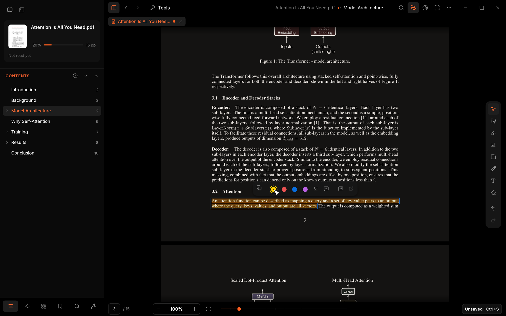
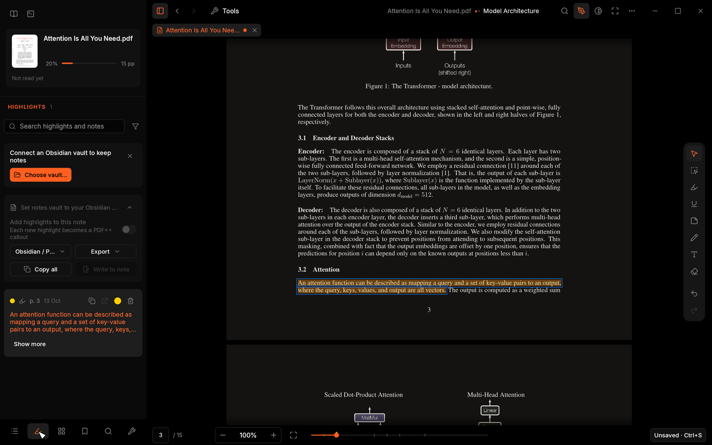
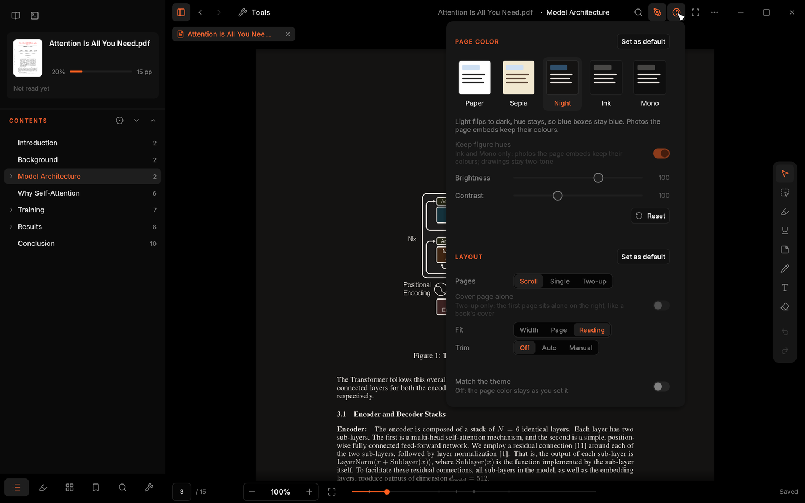
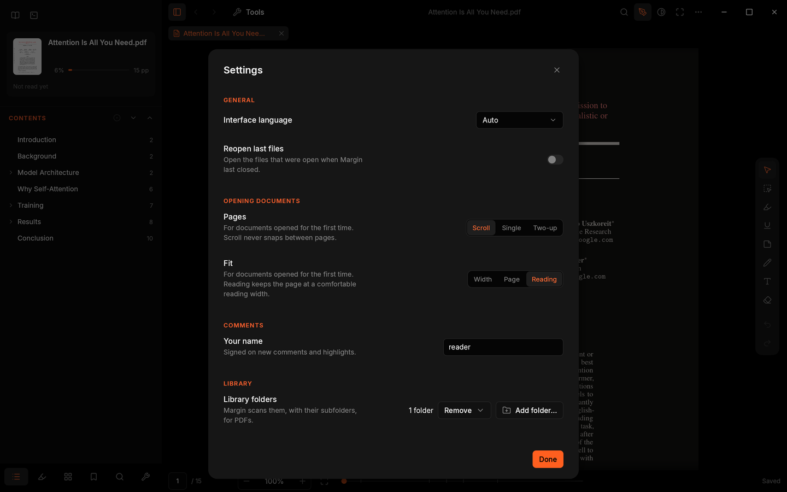

<p align="center">
  
</p>

<h1 align="center">Margin</h1>

<p align="center">
  <b>A reader-first PDF app for long reading: a library, a calm reader, and highlights that go straight to your notes.</b>
</p>

<p align="center">
  <a href="#license"></a>
  <a href="https://github.com/parthshr370/margin/releases"></a>
  <a href="https://www.rust-lang.org/"></a>
  
</p>

<p align="center">
  
</p>

Margin is a desktop PDF reader for papers, books and long documents. It opens into your library,
remembers exactly where you stopped in every file, and keeps highlights, notes and bookmarks with
the PDF. It is built on [PdfCraft](https://github.com/storytold/pdfcraft), an open-source PDF
application written in Rust, and uses PdfCraft's engine and renderer with an interface made for
reading.

Margin reads PDF only. It runs on Linux and macOS; there is no Windows build yet.

### At a glance

- **Opens into your library**, not an empty window, and reopens every PDF at the exact spot and
  zoom you left it.
- **Highlights are real PDF annotations**, so every other PDF reader sees them. They autosave.
- **Straight into Obsidian**: PDF++ style callouts, a reading note per paper that stays in sync,
  and exports for Markdown, Logseq, Readwise CSV and JSON.
- **Made for long reading**: five page colours with a Night mode that keeps photos in colour,
  automatic margin trim, a two-up book layout and a focus mode.
- **Works with LaTeX**: reloads after every build, with SyncTeX jumps both ways.
- **Private by default**: no account. Reading stats stay in a local file, and nothing leaves your
  machine unless you ask for a metadata lookup.
- **Configured like Zed**: settings, keymap and themes are commented JSON that reload as you save,
  and Zed theme files work as they are.
- **Small and native**: one Rust binary, about 25 MB to download on Linux.

## Contents

- [Features](#features)
- [Screenshots](#screenshots)
- [Install](#install)
- [Build from source](#build-from-source)
- [Configuration](#configuration)
- [LaTeX and SyncTeX](#latex-and-synctex)
- [Keyboard shortcuts](#keyboard-shortcuts)
- [Built on PdfCraft](#built-on-pdfcraft)
- [License](#license)

## Features

### Library

- **Library home.** Margin opens on a **Continue reading** card for the last book, then shelves for
  Recent, Reading, Finished, Folders, Collections and Tags, as a cover grid or a list. Sort by
  recent, title, author, progress or date added.
- **Search everything** (<kbd>/</kbd>). Titles, authors, file names, tags and details by default;
  turn on **In text** to search the pages and highlights of every book, and click a result to open
  that page. Book text is read in the background after each scan.
- **Folders scanned for you.** Folders in `library.folders` are scanned on start and on Rescan.
  Covers come from each first page, and a scan finds a paper's **DOI or arXiv id** in the file
  itself (metadata, XMP or first page).
- **Book details.** Right-click a book to open it, show it in its folder, mark it finished, add it
  to a collection, tag it or remove it. The details sheet edits title, authors, year, DOI, arXiv id
  and tags, and what you edit there is never overwritten by a scan, import or lookup.
- **Import from Zotero and BibTeX.** Read a BibTeX file (Zotero, Better BibTeX, JabRef, Mendeley)
  or Zotero's own `zotero.sqlite`. Entries fill in the books they match (by file, DOI, arXiv id, or
  title and year), keywords become tags, and missing PDFs are added. Zotero's database is copied
  and only the copy is read.
- **Metadata lookup, only when asked.** **Look up details** sends a book's DOI or arXiv id to
  Crossref (api.crossref.org) and arXiv (export.arxiv.org). Turn on `library.metadata_lookup` to
  do it for every new book after a scan.

### Reading stats

- **Reading time per page and per session**, kept in a local SQLite file (turn it off with
  `stats.enabled`).
- **The Reading stats sheet** (<kbd>Ctrl</kbd>+<kbd>Shift</kbd>+<kbd>T</kbd>) shows today, this
  week and the last 12 months, a **calendar heatmap**, **streaks** and a sortable table of books,
  and exports **CSV**.

### Reading

- **A quiet layout.** A header with the title and current section, a sidebar, a floating annotate
  rail, and a footer with the page field, zoom and a progress scrubber.
- **Page colours**: Paper, Sepia, Night, Ink and Mono, with brightness and contrast, and an option
  to follow the system's dark mode. **Night** flips light and dark but keeps hues, and photos and
  diagrams keep their colours.
- **Layouts**: continuous Scroll, Single page and **Two-up** (cover alone, like a book). Fit to
  width, to page, or to a comfortable reading width.
- **Trim margins**: hide white page margins automatically, or set them by hand (odd and even pages
  apart). The PDF itself is not changed.
- **Exact place, every time.** Every file reopens at the exact spot and zoom you left it, not only
  the page.
- **Back after a jump.** Back returns to where you were before a link, the outline, a search or the
  scrubber, with a short "Back to p. N" pill after each jump.
- **Smooth paging.** Space and Page Down move one screen and leave part of the previous one visible.
- **Focus mode** (<kbd>F</kbd>, or <kbd>Ctrl</kbd>+<kbd>H</kbd> on Linux and
  <kbd>Ctrl</kbd>+<kbd>Cmd</kbd>+<kbd>H</kbd> on macOS) hides the header, sidebar, footer and
  rail. Press the same key or <kbd>Esc</kbd> to leave. **Full screen** keeps a hidden top bar with
  the title and a way out.
- **Tabs.** With two or more documents open, a tab strip shows them: close with × or a middle
  click, drag to reorder, and a dot marks unsaved changes. <kbd>Ctrl</kbd>+<kbd>Tab</kbd> and
  <kbd>Alt</kbd>+<kbd>1</kbd>…<kbd>9</kbd> switch. Each tab keeps its own place, zoom, history and
  sidebar tab, and the Library lists them under Open now.
- **Sidebar tabs**: Contents (the outline, following the section you are reading), Highlights,
  Pages (thumbnails with highlight dots), Bookmarks, Find, and Tools (PdfCraft's page tools). In a
  narrow window the sidebar floats over the page.
- **Find in one place.** A field in the header, results in the sidebar's Find tab, with match case
  and whole-word options.
- **Text recognition (OCR)** for scanned pages, offered from Find or when you try to select text.
  Recognize one page or the whole document **locally**, with progress and Cancel. It adds an
  invisible text layer as one undoable edit; the image stays the same. Signed or restricted PDFs
  are never changed, and read-only files offer Save as first.
- **Live reload.** A file rewritten by another program (a LaTeX build, a sync client) reloads by
  itself at the same place, zoom and page colour (`reader.reload_on_change`). A half-written file
  keeps the version shown, and unsaved edits are never dropped: Margin asks first.
- **SyncTeX**: jump from a source line to the PDF and back (see [LaTeX](#latex-and-synctex)).

### Window

- **Linux: Margin's own title bar**, like Zed. Minimize, maximize and close sit at the right end of
  the header (or the Library's bar), the empty part of the row moves the window and maximizes it on
  a double click, and the edges and corners resize it. The buttons hide in full screen and focus
  mode. Set `ui.titlebar` to `"system"` to get your desktop's title bar back; it applies at once.
- **macOS: no separate title bar.** The traffic lights sit in Margin's header row, which moves the
  window and zooms it on a double click.
- **macOS menu bar.** Margin, File, Edit, View, Go, Window and Help run the same commands as the
  palette, with Open Recent and live Undo and Redo labels. Each row shows its shortcut from your
  keymap.

### Highlights and notes

- **Highlight from the selection.** Select text and a small bar appears: Copy, four highlight
  colours, Underline, Comment and Copy callout. The default colours are the PDF++ set: Yellow,
  Red, Note and Important.
- **Real PDF annotations.** Highlights, underlines, strikethroughs, squiggles, sticky notes, ink,
  text boxes and shapes are standard annotations, so other PDF readers see them too.
- **Works on read-only PDFs.** A file Margin can't write (read-only, signed, or one that forbids
  comment changes) keeps its highlights in its sidecar. They show like the rest, go to notes and
  exports, and **Save a copy with highlights** writes them into a new PDF as real annotations.
- **Page notes** (<kbd>Shift</kbd>+<kbd>N</kbd>) add a note to the page you are reading, beside
  the selected text if any. They show as small markers on the page.
- **The Highlights tab** lists every mark and page note as a card with its text, page, date and
  note. Search, filter by colour or kind, sort by page or newest, and recolour, copy, open or
  delete from the card.
- **Area snapshots.** Right-click the snapshot button, choose **Save snapshot to note**, and drag a
  region: Margin saves it as a 300 DPI PNG in your vault (`notes.snapshot_folder`) and adds it to
  the reading note with a link back to the page.

### Obsidian and exports

- **PDF++ callouts.** Copy a highlight as
  `> [!PDF|yellow] [[paper.pdf#page=4|paper, p.4]]` followed by the quote, or open the page in
  Obsidian.
- **A reading note that stays in sync.** With **Add highlights to this note** on, every new,
  edited, recoloured or deleted highlight reaches the note in the background. Margin only updates
  its own marked blocks: a block you edited in Obsidian is kept and reported, text outside Margin's
  blocks is never touched, and writes are atomic and stay inside the vault.
- **Export highlights** (and **Copy all**) as Obsidian/PDF++, plain Markdown, Logseq outline
  blocks, **Readwise CSV** or JSON. The CSV uses the columns
  [Readwise's import](https://docs.readwise.io/readwise/docs/importing-highlights) expects
  (`Highlight,Title,Author,URL,Note,Location,Date`, with the page as Location).
- **Export a paper as Markdown**: headings, paragraphs, lists and detected tables, with images as
  files beside it. **Export paper to vault** writes it next to the reading note with Obsidian image
  embeds, and never replaces a note or image already there.
- **Templates you control.** The vault, note path, front matter, highlight template, colours and
  export target live in the `notes` block of `settings.jsonc` or in Settings ▸ Notes (see
  [Obsidian](#obsidian)).
- **Guided first run.** The library starts with a setup card to connect a vault, add a library
  folder and open a PDF. **Not now** hides it for good; Settings ▸ Library and Settings ▸ Notes keep
  both changeable.

### Saving

- **Autosave.** Annotations in a writable PDF save about a second after your last change
  (`reader.autosave`; <kbd>Ctrl</kbd>+<kbd>S</kbd> still works), on a background worker. The footer
  says truthfully whether the file is saved, saving, failed, read-only or signed.
- **Your original bytes are kept.** Saves append to the PDF instead of rewriting it, and a session's
  saves coalesce into one revision. A file made read-only after opening is never replaced, and
  quitting waits for pending writes.
- **Sidecar files.** Your place, layout, page colour, trim, bookmarks, page notes and kept
  highlights live in a small `paper.pdf.margin.json` next to the PDF, or in Margin's data folder
  when that folder is not writable. Opening a file never writes one, and two Margins writing the
  same sidecar merge instead of losing changes. Set `reader.remember_per_document` to false to
  always use your global view defaults.

### Customisation

- **Plain-text config.** `settings.jsonc`, `keymap.jsonc` and `themes.json` are JSON with
  comments. Margin writes commented copies on first start and **reloads them as soon as you save**.
  The **Settings** window (<kbd>Ctrl</kbd>+<kbd>,</kbd>) changes the common ones without a text
  editor.
- **Themes like Zed.** Margin Dark and Margin Light are built in. Pick one with `"theme"`, write
  your own in `themes.json`, drop **Zed theme files** into `themes/`, or change a few colours with
  `"theme_overrides"` ([docs/margin/themes.md](docs/margin/themes.md)).
- **Keymap like Zed**, with contexts (Reader, Library, Selection, annotate mode and more). Press
  <kbd>?</kbd> for a keyboard sheet built from your current keymap, and
  <kbd>Ctrl</kbd>+<kbd>K</kbd> for the **command palette**.
- **Accessible.** Keyboard focus is always visible, and `ui.reduce_motion` turns off every
  animation.

## Screenshots

<table>
<tr>
<td width="50%"></td>
<td width="50%"></td>
</tr>
<tr>
<td align="center"><sub><b>Library</b>: continue reading, shelves and covers</sub></td>
<td align="center"><sub><b>Highlights</b>: every mark as a card, ready for Obsidian</sub></td>
</tr>
<tr>
<td width="50%"></td>
<td width="50%"></td>
</tr>
<tr>
<td align="center"><sub><b>Page colour and layout</b>, per document</sub></td>
<td align="center"><sub><b>Reading stats</b>: heatmap and streaks, all local</sub></td>
</tr>
</table>

## Install

Download a build from the [Releases page](https://github.com/parthshr370/margin/releases).
`<ver>` below is the version number, and `<arch>` is `x86_64` or `aarch64`. Each release has a
`SHA256SUMS` file; check a download with `sha256sum -c SHA256SUMS --ignore-missing`.

### Linux

| Format | File | How to install |
|---|---|---|
| AppImage | `margin-<ver>-linux-<arch>.AppImage` | `chmod +x margin-*.AppImage`, then run it. Works on most distributions. |
| Debian, Ubuntu | `margin-<ver>-linux-<arch>.deb` | `sudo apt install ./margin-<ver>-linux-<arch>.deb` |
| Fedora, openSUSE | `margin-<ver>-linux-<arch>.rpm` | `sudo dnf install ./margin-<ver>-linux-<arch>.rpm` (or `zypper install`) |
| Tarball | `margin-<ver>-linux-<arch>.tar.gz` | Extract it and run `bin/margin`, or copy `bin/` and `share/` into `~/.local`. |

The AppImage can update itself with
[AppImageUpdate](https://github.com/AppImageCommunity/AppImageUpdate), using the `.zsync` file
published next to it.

### macOS

Download `margin-<ver>-macos-universal.dmg` (one build for Apple silicon and Intel), open it and
drag **Margin** into **Applications**.

Margin is not signed with an Apple Developer ID and not notarized, so macOS blocks it the first
time. On macOS 15 (Sequoia) and later:

1. Open Margin once. macOS says it can't verify it; click **Done**.
2. Open **System Settings > Privacy & Security** and scroll down to **Security**.
3. Next to the message about Margin, click **Open Anyway**, then confirm with your password.

Or remove the quarantine flag in Terminal:

```sh
xattr -dr com.apple.quarantine /Applications/Margin.app
```

On macOS 14 and earlier, Control-click Margin in Applications, choose **Open**, then **Open** again.

## Build from source

You need Rust 1.90 or newer ([rustup](https://rustup.rs/)).

```sh
git clone https://github.com/parthshr370/margin.git
cd margin
cargo run --release -p margin
```

Pass PDFs to open them: `cargo run --release -p margin -- paper.pdf`. The binary ends up in
`target/release/margin`.

On Linux, install the windowing and graphics headers first. On Debian or Ubuntu:

```sh
sudo apt install libxkbcommon-dev libwayland-dev libx11-dev libxrandr-dev libxi-dev libgl1-mesa-dev
```

The packaging scripts for the release builds are in [`packaging/`](packaging/).
The macOS app/DMG and every Linux format include the Latin OCR models, their CC-BY-SA-4.0
licence texts and attribution. Packaging runs `cargo xtask models` to fetch and SHA-256 verify
them. For a development build, run that command yourself once; models live in the gitignored
`assets/models/` directory. Packaged Linux builds look in `share/margin/models` relative to
`bin/margin`, so keep both directories together when using the tarball.

## Configuration

The **Settings** window (<kbd>Ctrl</kbd>+<kbd>,</kbd>) covers the common options. Everything else,
and everything Settings changes, lives in plain files you can edit and keep in a dotfiles repo.

<p align="center">
  
</p>

Margin keeps its files in two folders:

| What | Linux | macOS |
|---|---|---|
| `settings.jsonc`, `keymap.jsonc`, `themes.json`, `themes/` | `~/.config/margin/` | `~/Library/Application Support/margin/` |
| Library, reading stats, covers, fallback sidecars | `~/.local/share/margin/` | `~/Library/Application Support/margin/` |

On Linux, `XDG_CONFIG_HOME` and `XDG_DATA_HOME` move these as usual. `MARGIN_CONFIG_DIR` and
`MARGIN_DATA_DIR` override them, which is handy for a portable setup or for testing.

Both files are written on first start with every option documented in comments and nothing set,
so later default changes still reach you. Uncomment what you want to change. Unknown or removed
keys are reported and ignored; bad values fall back to the setting below them, while valid keys
still apply. A broken file never stops Margin from starting. JSON schemas for editor completion
are written to `schemas/` in the same folder, and `default-settings.jsonc` lists every setting
with its default; Margin rewrites both on every start.

An example `settings.jsonc`:

```jsonc
{
  "view": {
    "layout": "two_up",      // "scroll" | "single" | "two_up"
    "cover_alone": true,     // two-up: page 1 alone, like a book
    "fit": "read",           // "width" | "page" | "read" | "content" | "zoom"
    "page_color": "night",   // "paper" | "sepia" | "night" | "ink" | "mono"
    "trim": true,
    "page_gap_px": 10,       // page and two-up column gutter
    "overlap_marker": true  // mark the previous screen edge after Space/PgDn
  },
  "reader": {
    "autosave": true,
    "remember_per_document": true,
    "back_stack": 100,      // 0 disables back/forward history
    "back_pill": true,
    "link_preview": true,   // hovering a link previews where it goes
    "reload_on_change": true,
    "synctex_click": "secondary-click", // Cmd+click (Ctrl+click elsewhere) opens reader.synctex_editor
    "selection_popover": true,
    "time_left": true,
    "undo_steps": 100,      // 0 disables undo/redo history
    "find": { "case": false, "whole_word": false }
  },
  "ui": {
    "reduce_motion": false,
    "titlebar": "margin",   // Linux: "margin" draws Margin's own window buttons; "system" = the desktop's title bar
    "rail": { "side": "right", "items": ["reader.tool.select", "comment.highlight", "|", "edit.undo", "edit.redo"] }
  },
  "library": { "folders": ["/home/you/Papers"], "view": "grid", "sort": "recent", "metadata_lookup": false },
  "stats": { "enabled": true }
}
```

The `view` block is the default for every document. Changes you make in the Display popover are
saved for that document only, unless you press **Set as default** there.

`reader.remember_per_document: false` opens with your global view settings and does not update
the document's saved reading position or view choices; bookmarks and annotations still persist.
The footer's `time_left` detail estimates the time left in the document once reading statistics
have a pace (the header already names the section). Rail items replace the default list in the
specified order; `|` adds a divider, an empty list hides the buttons, and unknown command ids are
skipped.

Only implemented settings appear in the generated defaults and schema. Legacy `perf.*`,
`reader.start`, `reader.find.regex`, `ui.rail.tool_options`, `view.gamma`, `view.saturation`,
`view.mono_threshold`, `view.white_threshold` and `view.dewatermark` are no longer supported;
these keys are reported and ignored without discarding other settings. `keys.base` supports
`margin` and `none`; the unshipped `okular` and `sioyek` values now warn and fall back to `margin`.

An example `keymap.jsonc`. Your bindings are applied over Margin's built-in keymap
([crates/margin-config/data/keymap.jsonc](crates/margin-config/data/keymap.jsonc)); `null`
removes a binding, and `secondary` means <kbd>Cmd</kbd> on macOS and <kbd>Ctrl</kbd> elsewhere.

```jsonc
[
  { "context": "Reader", "bindings": { "n": "reader.page.next", "p": "reader.page.prev", "shift-t": null } }
]
```

**Themes.** `"theme": "Margin Light"` picks one theme; `"theme": { "mode": "system", "light":
"Margin Light", "dark": "Margin Dark" }` follows your computer's appearance. Your own themes go in
`themes.json`, a theme family in Zed's format whose themes extend a built-in or each other; Zed
theme files work as they are in `themes/`. [docs/margin/themes.md](docs/margin/themes.md) lists
every style key and what it colours.

### Obsidian

Pick your vault in Settings ▸ Notes, or once from the command line; the choice is written to
`settings.jsonc`:

```sh
margin --notes.vault "/home/you/Obsidian/My Vault"
```

`--notes.note_template` sets where reading notes go inside the vault (default
`reading/{{title-slug}}.md`), and `--notes.colors "Yellow=#ffd000,Red=#ea5252"` sets the highlight
colours. PDF++ links work best when the PDF itself is inside the vault. A relative `notes.vault`
is not used, and the Highlights tab says why.

Templates use literal `{{variable}}` substitution, never code. Variables include `title`,
`title-slug`, `authors`, `year`, `doi`, `arxiv`, `citekey`, `tags`, `date`, `progress`, `page`,
`color`, `color-name`, `text`, `note`, `link` and `callout`; missing metadata is empty. Path
values are slugged, front-matter values are quote-escaped, and inserted values are never read as
templates again. `notes.update_mode: "append"` stops Margin from updating or deleting entries it
wrote before.

### LaTeX and SyncTeX

Build with SyncTeX on (`-synctex=1`; latexmk, LaTeX Workshop and vimtex do by default) so a
`paper.synctex.gz` sits beside `paper.pdf`. Margin reloads the PDF after each build.

**Inverse search** (PDF to source): <kbd>Cmd</kbd>+click on macOS, <kbd>Ctrl</kbd>+click elsewhere,
on the page runs the editor command in `reader.synctex_editor`. It runs without a shell: `{file}`,
`{line}` and `{column}` are filled in, and quotes keep words together. `reader.synctex_click`
picks `"secondary-click"`, `"secondary-shift-click"` or `"alt-click"` instead. That click on a link
(a citation, say) opens the source line and doesn't follow the link. On macOS, apps started from
the Dock don't see your shell's `PATH`, so give the editor's full path.

**Forward search** (source to PDF): `margin --forward-search FILE.tex:LINE[:COLUMN] paper.pdf`
opens the PDF (or brings it forward), scrolls to the line and outlines it briefly. When Margin is
already running, this launch hands the request to it through Margin's data folder
(`forward-search/`) and exits; only your own user can write there. Point editors at the `margin`
binary itself (on macOS, `/Applications/Margin.app/Contents/MacOS/margin`): `open -a Margin` can't
pass a line.

VS Code with LaTeX Workshop (`settings.json`):

```jsonc
"latex-workshop.view.pdf.viewer": "external",
"latex-workshop.view.pdf.external.viewer.command": "margin",
"latex-workshop.view.pdf.external.viewer.args": ["%PDF%"],
"latex-workshop.view.pdf.external.synctex.command": "margin",
"latex-workshop.view.pdf.external.synctex.args": ["--forward-search", "%TEX%:%LINE%", "%PDF%"]
```

and in Margin's `settings.jsonc`: `"reader": { "synctex_editor": "code -g {file}:{line}" }`.

vimtex (`init.vim`; `\lv` runs forward search):

```vim
let g:vimtex_view_method = 'general'
let g:vimtex_view_general_viewer = 'margin'
let g:vimtex_view_general_options = '--forward-search @tex:@line @pdf'
```

and `"reader": { "synctex_editor": "nvim --headless -c \"VimtexInverseSearch {line} '{file}'\"" }`.

Zed: a task for forward search (`~/.config/zed/tasks.json`), run from the task picker or bound to
a key:

```jsonc
[{ "label": "Margin: show in PDF", "command": "margin",
   "args": ["--forward-search", "$ZED_FILE:$ZED_ROW", "$ZED_DIRNAME/$ZED_STEM.pdf"] }]
```

and `"reader": { "synctex_editor": "zed {file}:{line}" }`.

## Keyboard shortcuts

<kbd>Ctrl</kbd> is <kbd>Cmd</kbd> on macOS. Press <kbd>?</kbd> in Margin for the full list, taken
from your keymap. On macOS the menu bar shows each command's <kbd>Cmd</kbd> shortcut beside it.

| Action | Keys |
|---|---|
| Command palette | <kbd>Ctrl</kbd>+<kbd>K</kbd> |
| Open a file | <kbd>Ctrl</kbd>+<kbd>O</kbd> |
| Library | <kbd>Ctrl</kbd>+<kbd>Shift</kbd>+<kbd>O</kbd> |
| Reading stats | <kbd>Ctrl</kbd>+<kbd>Shift</kbd>+<kbd>T</kbd> |
| Settings | <kbd>Ctrl</kbd>+<kbd>,</kbd> |
| Keyboard sheet | <kbd>?</kbd> |
| Find | <kbd>/</kbd> or <kbd>Ctrl</kbd>+<kbd>F</kbd> |
| Next / previous match | <kbd>Enter</kbd> / <kbd>Shift</kbd>+<kbd>Enter</kbd>, <kbd>F3</kbd> / <kbd>Shift</kbd>+<kbd>F3</kbd>, <kbd>Ctrl</kbd>+<kbd>G</kbd> / <kbd>Ctrl</kbd>+<kbd>Shift</kbd>+<kbd>G</kbd> |
| Scroll a line | <kbd>J</kbd> / <kbd>K</kbd>, <kbd>↓</kbd> / <kbd>↑</kbd> (in Single, <kbd>J</kbd> / <kbd>K</kbd> turn the page) |
| Scroll a screen | <kbd>Space</kbd> / <kbd>Shift</kbd>+<kbd>Space</kbd>, <kbd>PgDn</kbd> / <kbd>PgUp</kbd> |
| Next / previous page | <kbd>→</kbd> / <kbd>←</kbd> |
| First / last page | <kbd>Home</kbd> / <kbd>End</kbd> |
| Go to page | <kbd>G</kbd> |
| Back / forward | <kbd>Alt</kbd>+<kbd>←</kbd> / <kbd>Alt</kbd>+<kbd>→</kbd>, <kbd>Ctrl</kbd>+<kbd>[</kbd> / <kbd>Ctrl</kbd>+<kbd>]</kbd> |
| Zoom in / out / 100% | <kbd>Ctrl</kbd>+<kbd>=</kbd> / <kbd>Ctrl</kbd>+<kbd>-</kbd> / <kbd>Ctrl</kbd>+<kbd>0</kbd> |
| Toggle fit width and reading width | <kbd>W</kbd> |
| Trim margins | <kbd>Shift</kbd>+<kbd>T</kbd> |
| Rotate | <kbd>Ctrl</kbd>+<kbd>R</kbd> / <kbd>Ctrl</kbd>+<kbd>Shift</kbd>+<kbd>R</kbd> |
| Full screen reading | <kbd>Ctrl</kbd>+<kbd>L</kbd> (leave with <kbd>Esc</kbd>; on macOS, View ▸ Full Screen Reading, next to the system's Enter Full Screen) |
| Toggle sidebar | <kbd>[</kbd> |
| Contents / Highlights / Pages / Bookmarks tab | <kbd>Ctrl</kbd>+<kbd>1</kbd> / <kbd>2</kbd> / <kbd>3</kbd> / <kbd>4</kbd> |
| Next / previous open document | <kbd>Ctrl</kbd>+<kbd>Tab</kbd> / <kbd>Ctrl</kbd>+<kbd>Shift</kbd>+<kbd>Tab</kbd> (also <kbd>Ctrl</kbd> on macOS) |
| Open document 1…8, last | <kbd>Alt</kbd>+<kbd>1</kbd>…<kbd>8</kbd>, <kbd>Alt</kbd>+<kbd>9</kbd> |
| Open the source line (SyncTeX) | <kbd>Ctrl</kbd>+click on the page |
| Bookmark this page | <kbd>B</kbd> |
| Add a note to the page | <kbd>Shift</kbd>+<kbd>N</kbd> |
| Annotate tools | <kbd>A</kbd> |
| With text selected: highlight, underline, strikethrough, squiggly | <kbd>H</kbd>, <kbd>U</kbd>, <kbd>S</kbd>, <kbd>Q</kbd> |
| With text or a mark selected: Yellow, Red, Note, Important | <kbd>1</kbd>, <kbd>2</kbd>, <kbd>3</kbd>, <kbd>4</kbd> |
| Delete the selected mark | <kbd>Delete</kbd> or <kbd>Backspace</kbd> |
| In annotate mode: select, snapshot, highlight, underline, strikethrough, squiggly, note, pen, text box, rectangle, eraser | <kbd>V</kbd> <kbd>C</kbd> <kbd>H</kbd> <kbd>U</kbd> <kbd>S</kbd> <kbd>Q</kbd> <kbd>N</kbd> <kbd>P</kbd> <kbd>T</kbd> <kbd>R</kbd> <kbd>E</kbd> |
| Undo / redo | <kbd>Ctrl</kbd>+<kbd>Z</kbd> / <kbd>Ctrl</kbd>+<kbd>Shift</kbd>+<kbd>Z</kbd> |
| Save / save as | <kbd>Ctrl</kbd>+<kbd>S</kbd> / <kbd>Ctrl</kbd>+<kbd>Shift</kbd>+<kbd>S</kbd> |
| Print | <kbd>Ctrl</kbd>+<kbd>P</kbd> |
| Close the document | <kbd>Ctrl</kbd>+<kbd>W</kbd> |

## Built on PdfCraft

Margin is a flavour of [PdfCraft](https://github.com/storytold/pdfcraft), the open-source,
clean-room PDF application written in Rust by Brandon Thomas, the ArtCraft team and the PdfCraft
contributors. Everything that makes a PDF show up on screen and stay correct (parsing, rendering,
text extraction, search, annotations, saving, undo, printing, the page tools) is PdfCraft's work.
Margin adds a reading interface, a library, reading state and notes on top. Thank you to Brandon
and to every PdfCraft contributor; their commits are kept in this repository's history.

This repository is PdfCraft's source with Margin added, not a separate rewrite:

| Path | What it is |
|---|---|
| [`apps/margin`](apps/margin) | The `margin` binary. It starts PdfCraft's interface with `Flavor::Margin`. |
| [`crates/ui-egui/src/margin`](crates/ui-egui/src/margin) | Margin's interface: reader layout, library, stats, highlights, Obsidian, page colours, trim, find, keys. |
| [`crates/margin-config`](crates/margin-config) | Settings, keymap, sidecars, library and stats databases. No interface code. |
| [`packaging/margin`](packaging/margin) | Margin's release packaging, reusing PdfCraft's scripts. |
| Everything else | PdfCraft as upstream ships it, including the `pdfcraft` app and `pdfcraft-cli`. |

Margin code goes in new files. Where Margin needs to change a PdfCraft file, the change is a small
hook that branches on `Flavor::Margin`, so the PdfCraft app built from this repository looks and
works like upstream's. `cargo run -p pdfcraft` still builds and runs PdfCraft itself.

Upstream changes are merged, not rebased, so history stays intact:

```sh
git remote add upstream https://github.com/storytold/pdfcraft.git
git fetch upstream
git merge upstream/main
```

PdfCraft's own README, with its full feature list and design notes, is kept at
[docs/PDFCRAFT-README.md](docs/PDFCRAFT-README.md). Bugs in PDF parsing or rendering usually
belong upstream; please report them to PdfCraft if you can reproduce them there too.

## License

Margin is dual-licensed under [MIT](LICENSE-MIT) or [Apache-2.0](LICENSE-APACHE), at your option,
the same terms as PdfCraft. Margin is Copyright (c) 2026 Parth Sharma; PdfCraft is Copyright (c)
2026 ArtCraft Team and the PdfCraft contributors. Required notices are in [NOTICE](NOTICE).

Bundled fonts, icons and other assets keep their own open licenses; each one is listed with its
author, source and license in [ATTRIBUTION.md](ATTRIBUTION.md).

Margin is based on PdfCraft by the ArtCraft team and contributors. The ArtCraft name and logos are
trademarks of the ArtCraft Team and are not covered by the license above. As PdfCraft's brand
licence requires for derived works, the ArtCraft logos have been removed from this repository and
from Margin builds. Margin is not an ArtCraft product and is not made, sponsored or endorsed by the
ArtCraft Team.
