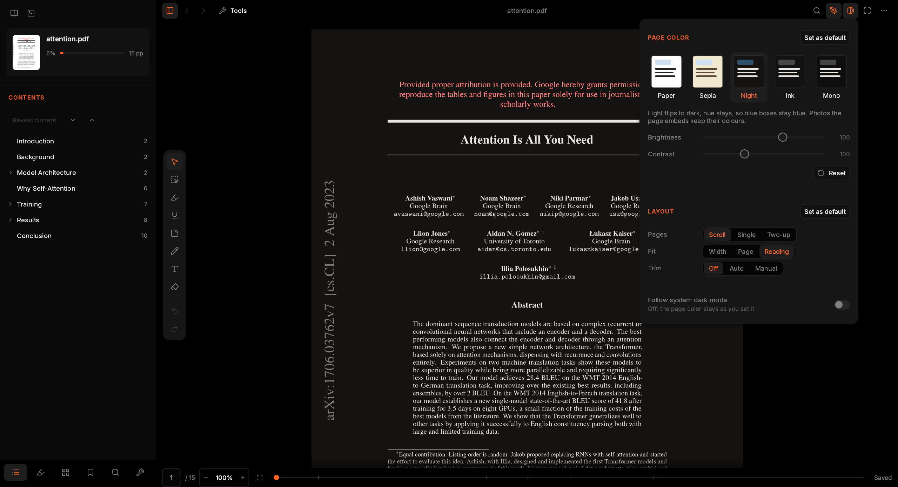
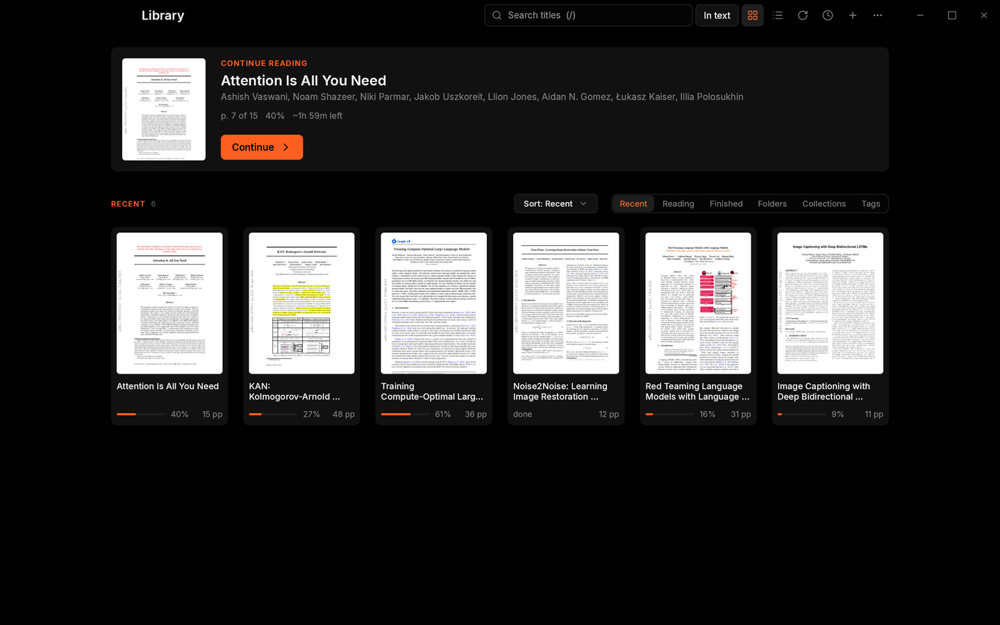
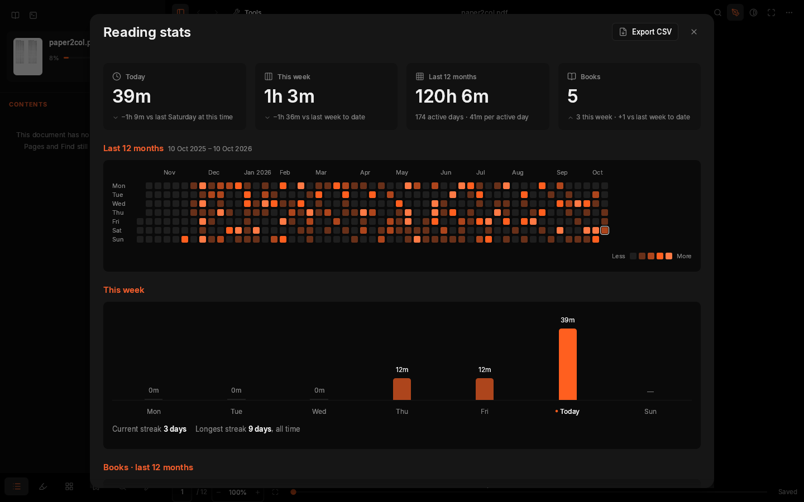

<p align="center">
  
</p>

<h1 align="center">Margin</h1>

<p align="center">
  <b>A reader-first PDF app for long reading: a library, a calm reader, and highlights that go straight to your notes.</b>
</p>

<p align="center">
  <a href="#license"></a>
  <a href="https://github.com/parthshr370/margin/releases"></a>
  <a href="https://www.rust-lang.org/"></a>
  
</p>

<p align="center">
  
</p>

Margin is a desktop PDF reader for papers, books and long documents. It opens into your library,
remembers exactly where you stopped in every file, and keeps highlights, notes and bookmarks with
the PDF. It is built on [PdfCraft](https://github.com/storytold/pdfcraft), an open-source PDF
application written in Rust, and uses PdfCraft's engine and renderer with an interface made for
reading.

Margin reads PDF only. It runs on Linux and macOS; there is no Windows build yet.

## Contents

- [Features](#features)
- [Screenshots](#screenshots)
- [Install](#install)
- [Build from source](#build-from-source)
- [Configuration](#configuration)
- [Keyboard shortcuts](#keyboard-shortcuts)
- [Built on PdfCraft](#built-on-pdfcraft)
- [License](#license)

## Features

**Library and reading stats**

- A library is the home screen: a Continue reading card that opens the last book at its page,
  then shelves for Recent, Reading, Finished, Folders and Collections, as a cover grid or a list,
  with search (<kbd>/</kbd>) and sort by recent, title, author, progress or date added.
- Covers come from each PDF's first page. Folders listed in `library.folders` are scanned on
  start and on Rescan, in the background.
- Right-click a book to open it, show it in its folder, mark it finished, add it to a collection or
  remove it.
- Reading time is recorded per page and per session in a local SQLite file (turn it off with
  `stats.enabled`). The Reading stats sheet (<kbd>Ctrl</kbd>+<kbd>Shift</kbd>+<kbd>T</kbd>) shows
  today, this week and the last 12 months, a calendar heatmap, streaks and a sortable table of
  books, and exports CSV. Nothing leaves your machine.

**Reading**

- A quiet layout: a header with the title and current section, a sidebar, a floating annotate
  rail and a footer with the page field, zoom and a progress scrubber.
- Page colours: Paper, Sepia, Night, Ink and Mono, with brightness and contrast and an option to
  follow the system's dark mode. Night flips light and dark but keeps hues, and photos and
  diagrams keep their colours in the dark modes.
- Layouts: continuous Scroll, Single page and Two-up (with the cover alone, like a book). Fit to
  width, to page, or to a comfortable reading width.
- Trim: hide white page margins automatically, or set them by hand (odd and even pages apart).
  The PDF itself is not changed.
- Margin reopens every file at the exact spot and zoom you left it, not only the page.
- Back returns to the exact place before a jump (a link, the outline, a search, the scrubber), with
  a short "Back to p. N" pill after each jump.
- Smooth screen steps with Space and Page Down that leave part of the previous screen visible.
- Focus mode (<kbd>F</kbd>, or the <kbd>ctrl-secondary-h</kbd> keymap binding) hides the header,
  sidebar, footer and annotate rail without changing the sidebar choice; toggle again or press
  <kbd>Esc</kbd> to leave.
- Full screen with a hidden top bar that shows the title and a way out.
- Find lives in one place: a field in the header and its results in the sidebar's Find tab, with
  match case and whole-word options.
- Sidebar tabs: Contents (the outline, following the section you are reading), Highlights, Pages
  (a thumbnail grid with the current page marked and highlight dots), Bookmarks, Find, and Tools
  (PdfCraft's tools that work in this build). In a narrow window the sidebar floats over the page.

**Highlights and notes**

- Select text and a small bar appears beside it: Copy, four highlight colours, Underline, Comment
  and Copy callout. The default colours are the PDF++ set: Yellow, Red, Note and Important.
- Highlights, underlines, strikethroughs, squiggles, sticky notes, ink, text boxes and shapes are
  real PDF annotations, so other PDF readers see them too.
- The Highlights tab lists every mark as a card with the text it covers, its page, date and note.
  Change a colour, copy, open or delete from the card.
- Obsidian: copy a highlight as a PDF++ style callout
  (`> [!PDF|yellow] [[paper.pdf#page=4|paper, p.4]]` followed by the quote), open the page in
  Obsidian, copy all highlights as Markdown, or write them to a reading note in your vault. Writing
  only appends and never duplicates an entry, and Margin never writes outside the vault.

**Saving**

- Annotations in a writable PDF autosave about a second after your last change (`reader.autosave`;
  <kbd>Ctrl</kbd>+<kbd>S</kbd> still works). Serialization and atomic replacement run on a
  background worker; edits made during a save remain dirty until the next write completes.
  The footer says truthfully whether the file is saved, saving, failed, read-only or signed.
  Within an unsigned document's session, incremental saves coalesce into one revision while
  preserving the original PDF bytes. Edits that require a full rewrite, such as applying
  redactions, still use that safe rewrite. Quitting waits for pending writes.
- Your place, layout, page colour, trim and page bookmarks live in a small sidecar file next to
  the PDF (`paper.pdf.margin.json`), or in Margin's data folder when that folder is not writable.
  Sidecars are never written just because you opened a file.
  Set `reader.remember_per_document` to false to use your global view defaults and stop restoring
  or updating per-document positions and view settings; bookmarks and annotations still persist.

**Customisation**

- `settings.jsonc` and `keymap.jsonc` are plain JSON with comments. Margin writes commented
  copies on first start and reloads them as soon as you save.
- The keymap uses Zed's format with contexts (Reader, Library, Selection, annotate mode and more).
  Press <kbd>?</kbd> for a keyboard sheet generated from your current keymap, and
  <kbd>Ctrl</kbd>+<kbd>K</kbd> for the command palette.
- Keyboard focus is always visible, and `ui.reduce_motion` turns off every animation.

## Screenshots

<table>
<tr>
<td width="50%"></td>
<td width="50%"></td>
</tr>
<tr>
<td align="center"><sub>The library</sub></td>
<td align="center"><sub>Reading stats</sub></td>
</tr>
</table>

## Install

Download a build from the [Releases page](https://github.com/parthshr370/margin/releases).
`<ver>` below is the version number, and `<arch>` is `x86_64` or `aarch64`. Each release has a
`SHA256SUMS` file; check a download with `sha256sum -c SHA256SUMS --ignore-missing`.

### Linux

| Format | File | How to install |
|---|---|---|
| AppImage | `margin-<ver>-linux-<arch>.AppImage` | `chmod +x margin-*.AppImage`, then run it. Works on most distributions. |
| Debian, Ubuntu | `margin-<ver>-linux-<arch>.deb` | `sudo apt install ./margin-<ver>-linux-<arch>.deb` |
| Fedora, openSUSE | `margin-<ver>-linux-<arch>.rpm` | `sudo dnf install ./margin-<ver>-linux-<arch>.rpm` (or `zypper install`) |
| Tarball | `margin-<ver>-linux-<arch>.tar.gz` | Extract it and run `bin/margin`, or copy `bin/` and `share/` into `~/.local`. |

The AppImage can update itself with
[AppImageUpdate](https://github.com/AppImageCommunity/AppImageUpdate), using the `.zsync` file
published next to it.

### macOS

Download `margin-<ver>-macos-universal.dmg` (one build for Apple silicon and Intel), open it and
drag **Margin** into **Applications**.

Margin is not signed with an Apple Developer ID and not notarized, so macOS blocks it the first
time. On macOS 15 (Sequoia) and later:

1. Open Margin once. macOS says it can't verify it; click **Done**.
2. Open **System Settings > Privacy & Security** and scroll down to **Security**.
3. Next to the message about Margin, click **Open Anyway**, then confirm with your password.

Or remove the quarantine flag in Terminal:

```sh
xattr -dr com.apple.quarantine /Applications/Margin.app
```

On macOS 14 and earlier, Control-click Margin in Applications, choose **Open**, then **Open** again.

## Build from source

You need Rust 1.90 or newer ([rustup](https://rustup.rs/)).

```sh
git clone https://github.com/parthshr370/margin.git
cd margin
cargo run --release -p margin
```

Pass PDFs to open them: `cargo run --release -p margin -- paper.pdf`. The binary ends up in
`target/release/margin`.

On Linux, install the windowing and graphics headers first. On Debian or Ubuntu:

```sh
sudo apt install libxkbcommon-dev libwayland-dev libx11-dev libxrandr-dev libxi-dev libgl1-mesa-dev
```

The packaging scripts for the release builds are in [`packaging/`](packaging/).

## Configuration

Margin keeps its files in two folders:

| What | Linux | macOS |
|---|---|---|
| `settings.jsonc`, `keymap.jsonc` | `~/.config/margin/` | `~/Library/Application Support/margin/` |
| Library, reading stats, covers, fallback sidecars | `~/.local/share/margin/` | `~/Library/Application Support/margin/` |

On Linux, `XDG_CONFIG_HOME` and `XDG_DATA_HOME` move these as usual. `MARGIN_CONFIG_DIR` and
`MARGIN_DATA_DIR` override them, which is handy for a portable setup or for testing.

Both files are written on first start with every option documented in comments and nothing set,
so later default changes still reach you. Uncomment what you want to change. Unknown or removed
keys are reported and ignored; bad values fall back to the setting below them, while valid keys
still apply. A broken file never stops Margin from starting. A JSON schema for editor completion
is written to `schemas/` in the same folder.

An example `settings.jsonc`:

```jsonc
{
  "view": {
    "layout": "two_up",      // "scroll" | "single" | "two_up"
    "cover_alone": true,     // two-up: page 1 alone, like a book
    "fit": "read",           // "width" | "page" | "read" | "content" | "zoom"
    "page_color": "night",   // "paper" | "sepia" | "night" | "ink" | "mono"
    "trim": true,
    "page_gap_px": 10,       // page and two-up column gutter
    "overlap_marker": true  // mark the previous screen edge after Space/PgDn
  },
  "reader": {
    "autosave": true,
    "remember_per_document": true,
    "back_stack": 100,      // 0 disables back/forward history
    "back_pill": true,
    "selection_popover": true,
    "time_left": true,
    "undo_steps": 100,      // 0 disables undo/redo history
    "find": { "case": false, "whole_word": false }
  },
  "ui": {
    "reduce_motion": false,
    "rail": { "side": "right", "items": ["reader.tool.select", "comment.highlight", "|", "edit.undo", "edit.redo"] }
  },
  "library": { "folders": ["/home/you/Papers"], "view": "grid", "sort": "recent" },
  "stats": { "enabled": true }
}
```

The `view` block is the default for every document. Changes you make in the Display popover are
saved for that document only, unless you press **Set as default** there.

`reader.remember_per_document: false` opens with your global view settings and does not update
the document's saved reading position or view choices; bookmarks and annotations still persist.
The footer's `time_left` detail shows the current section and, once reading statistics have a
pace, an estimate of the time remaining. Rail items replace the default list in the specified
order; `|` adds a divider, an empty list hides the buttons, and unknown command ids are skipped.

Only implemented settings appear in the generated defaults and schema. Legacy `perf.*`,
`reader.start`, `reader.find.regex`, `ui.rail.tool_options`, `view.gamma`, `view.saturation`,
`view.mono_threshold`, `view.white_threshold` and `view.dewatermark` are no longer supported;
these keys are reported and ignored without discarding other settings. `keys.base` supports
`margin` and `none`; the unshipped `okular` and `sioyek` values now warn and fall back to `margin`.

An example `keymap.jsonc`. Your bindings are applied over Margin's built-in keymap
([crates/margin-config/data/keymap.jsonc](crates/margin-config/data/keymap.jsonc)); `null`
removes a binding, and `secondary` means <kbd>Cmd</kbd> on macOS and <kbd>Ctrl</kbd> elsewhere.

```jsonc
[
  { "context": "Reader", "bindings": { "n": "reader.page.next", "p": "reader.page.prev", "shift-t": null } }
]
```

**Obsidian.** Point Margin at your vault once from the command line; it remembers the choice:

```sh
margin --notes.vault "/home/you/Obsidian/My Vault"
```

`--notes.note_template` sets where reading notes go inside the vault (default
`reading/{{title-slug}}.md`), and `--notes.colors "Yellow=#ffd000,Red=#ea5252"` sets the highlight
colours. PDF++ links work best when the PDF itself is inside the vault.

## Keyboard shortcuts

<kbd>Ctrl</kbd> is <kbd>Cmd</kbd> on macOS. Press <kbd>?</kbd> in Margin for the full list, taken
from your keymap.

| Action | Keys |
|---|---|
| Command palette | <kbd>Ctrl</kbd>+<kbd>K</kbd> |
| Open a file | <kbd>Ctrl</kbd>+<kbd>O</kbd> |
| Library | <kbd>Ctrl</kbd>+<kbd>Shift</kbd>+<kbd>O</kbd> |
| Reading stats | <kbd>Ctrl</kbd>+<kbd>Shift</kbd>+<kbd>T</kbd> |
| Settings | <kbd>Ctrl</kbd>+<kbd>,</kbd> |
| Keyboard sheet | <kbd>?</kbd> |
| Find | <kbd>/</kbd> or <kbd>Ctrl</kbd>+<kbd>F</kbd> |
| Next / previous match | <kbd>Enter</kbd> / <kbd>Shift</kbd>+<kbd>Enter</kbd>, <kbd>F3</kbd> / <kbd>Shift</kbd>+<kbd>F3</kbd>, <kbd>Ctrl</kbd>+<kbd>G</kbd> / <kbd>Ctrl</kbd>+<kbd>Shift</kbd>+<kbd>G</kbd> |
| Scroll a line | <kbd>J</kbd> / <kbd>K</kbd>, <kbd>↓</kbd> / <kbd>↑</kbd> (in Single, <kbd>J</kbd> / <kbd>K</kbd> turn the page) |
| Scroll a screen | <kbd>Space</kbd> / <kbd>Shift</kbd>+<kbd>Space</kbd>, <kbd>PgDn</kbd> / <kbd>PgUp</kbd> |
| Next / previous page | <kbd>→</kbd> / <kbd>←</kbd> |
| First / last page | <kbd>Home</kbd> / <kbd>End</kbd> |
| Go to page | <kbd>G</kbd> |
| Back / forward | <kbd>Alt</kbd>+<kbd>←</kbd> / <kbd>Alt</kbd>+<kbd>→</kbd>, <kbd>Ctrl</kbd>+<kbd>[</kbd> / <kbd>Ctrl</kbd>+<kbd>]</kbd> |
| Zoom in / out / 100% | <kbd>Ctrl</kbd>+<kbd>=</kbd> / <kbd>Ctrl</kbd>+<kbd>-</kbd> / <kbd>Ctrl</kbd>+<kbd>0</kbd> |
| Toggle fit width and reading width | <kbd>W</kbd> |
| Trim margins | <kbd>Shift</kbd>+<kbd>T</kbd> |
| Rotate | <kbd>Ctrl</kbd>+<kbd>R</kbd> / <kbd>Ctrl</kbd>+<kbd>Shift</kbd>+<kbd>R</kbd> |
| Full screen | <kbd>Ctrl</kbd>+<kbd>L</kbd> (leave with <kbd>Esc</kbd>) |
| Toggle sidebar | <kbd>[</kbd> |
| Contents / Highlights / Pages / Bookmarks tab | <kbd>Ctrl</kbd>+<kbd>1</kbd> / <kbd>2</kbd> / <kbd>3</kbd> / <kbd>4</kbd> |
| Bookmark this page | <kbd>B</kbd> |
| Annotate tools | <kbd>A</kbd> |
| With text selected: highlight, underline, strikethrough, squiggly | <kbd>H</kbd>, <kbd>U</kbd>, <kbd>S</kbd>, <kbd>Q</kbd> |
| With text or a mark selected: Yellow, Red, Note, Important | <kbd>1</kbd>, <kbd>2</kbd>, <kbd>3</kbd>, <kbd>4</kbd> |
| Delete the selected mark | <kbd>Delete</kbd> or <kbd>Backspace</kbd> |
| In annotate mode: select, snapshot, highlight, underline, strikethrough, squiggly, note, pen, text box, rectangle, eraser | <kbd>V</kbd> <kbd>C</kbd> <kbd>H</kbd> <kbd>U</kbd> <kbd>S</kbd> <kbd>Q</kbd> <kbd>N</kbd> <kbd>P</kbd> <kbd>T</kbd> <kbd>R</kbd> <kbd>E</kbd> |
| Undo / redo | <kbd>Ctrl</kbd>+<kbd>Z</kbd> / <kbd>Ctrl</kbd>+<kbd>Shift</kbd>+<kbd>Z</kbd> |
| Save / save as | <kbd>Ctrl</kbd>+<kbd>S</kbd> / <kbd>Ctrl</kbd>+<kbd>Shift</kbd>+<kbd>S</kbd> |
| Print | <kbd>Ctrl</kbd>+<kbd>P</kbd> |
| Close the document | <kbd>Ctrl</kbd>+<kbd>W</kbd> |

## Built on PdfCraft

Margin is a flavour of [PdfCraft](https://github.com/storytold/pdfcraft), the open-source,
clean-room PDF application written in Rust by Brandon Thomas, the ArtCraft team and the PdfCraft
contributors. Everything that makes a PDF show up on screen and stay correct (parsing, rendering,
text extraction, search, annotations, saving, undo, printing, the page tools) is PdfCraft's work.
Margin adds a reading interface, a library, reading state and notes on top. Thank you to Brandon
and to every PdfCraft contributor; their commits are kept in this repository's history.

This repository is PdfCraft's source with Margin added, not a separate rewrite:

| Path | What it is |
|---|---|
| [`apps/margin`](apps/margin) | The `margin` binary. It starts PdfCraft's interface with `Flavor::Margin`. |
| [`crates/ui-egui/src/margin`](crates/ui-egui/src/margin) | Margin's interface: reader layout, library, stats, highlights, Obsidian, page colours, trim, find, keys. |
| [`crates/margin-config`](crates/margin-config) | Settings, keymap, sidecars, library and stats databases. No interface code. |
| [`packaging/margin`](packaging/margin) | Margin's release packaging, reusing PdfCraft's scripts. |
| Everything else | PdfCraft as upstream ships it, including the `pdfcraft` app and `pdfcraft-cli`. |

Margin code goes in new files. Where Margin needs to change a PdfCraft file, the change is a small
hook that branches on `Flavor::Margin`, so the PdfCraft app built from this repository looks and
works like upstream's. `cargo run -p pdfcraft` still builds and runs PdfCraft itself.

Upstream changes are merged, not rebased, so history stays intact:

```sh
git remote add upstream https://github.com/storytold/pdfcraft.git
git fetch upstream
git merge upstream/main
```

PdfCraft's own README, with its full feature list and design notes, is kept at
[docs/PDFCRAFT-README.md](docs/PDFCRAFT-README.md). Bugs in PDF parsing or rendering usually
belong upstream; please report them to PdfCraft if you can reproduce them there too.

## License

Margin is dual-licensed under [MIT](LICENSE-MIT) or [Apache-2.0](LICENSE-APACHE), at your option,
the same terms as PdfCraft. Margin is Copyright (c) 2026 Parth Sharma; PdfCraft is Copyright (c)
2026 ArtCraft Team and the PdfCraft contributors. Required notices are in [NOTICE](NOTICE).

Bundled fonts, icons and other assets keep their own open licenses; each one is listed with its
author, source and license in [ATTRIBUTION.md](ATTRIBUTION.md).

Margin is based on PdfCraft by the ArtCraft team and contributors. The ArtCraft name and logos are
trademarks of the ArtCraft Team and are not covered by the license above. As PdfCraft's brand
licence requires for derived works, the ArtCraft logos have been removed from this repository and
from Margin builds. Margin is not an ArtCraft product and is not made, sponsored or endorsed by the
ArtCraft Team.
